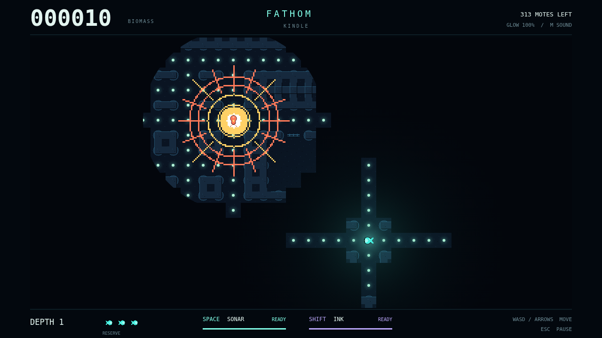

# Fathom

You are a small light in a very deep place. Slip through flooded stone corridors,
graze the glowing plankton, and learn a maze that only appears where your light
can reach. Each mouthful widens your circle of vision. It also makes you easier
to find.

The deep is full of misleading signals. An amber jellyfish might be a generous
meal, or a Lanternjaw hiding its jaws. An eyeless Gloamfin listens through walls
and ink; its violet ping sweeps the passages, and an orange one means it is
searching for you. Somewhere out of sight, a Flarefish begins to charge.

Send a cyan sonar crest around corners to remember the way ahead and catch a
glimpse of the hunters. Listen before you send the next one: sound carries both
ways. Leave ink behind to break a light-hunter's fix, turn sharply to shake a
listener, and keep track of the corridors that disappear beyond your shrinking
window.

Clear the final mote and descend, carrying your score into a darker hunt with
more predators and less sonar reach. Three lives wait in reserve. The maze
remembers what you have explored. How much of it will you remember?

